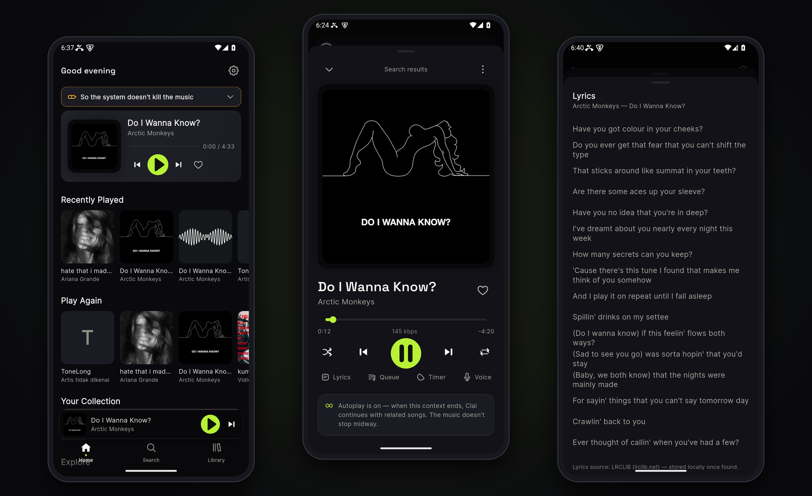
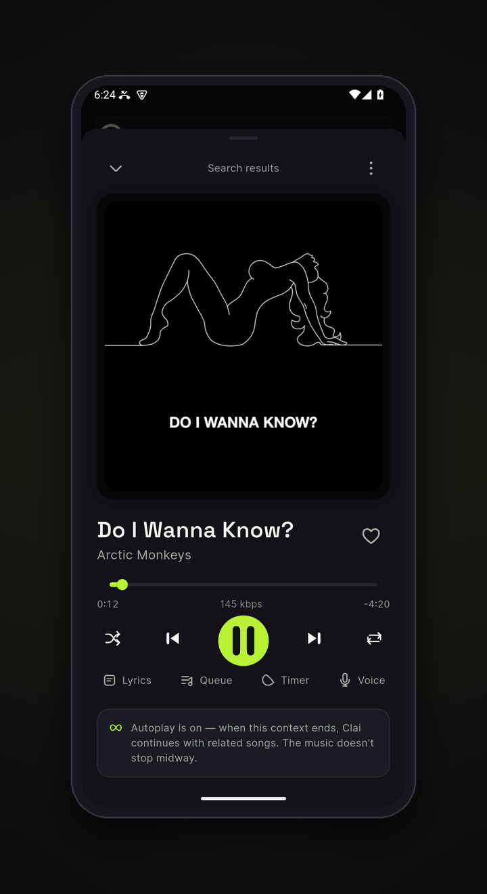
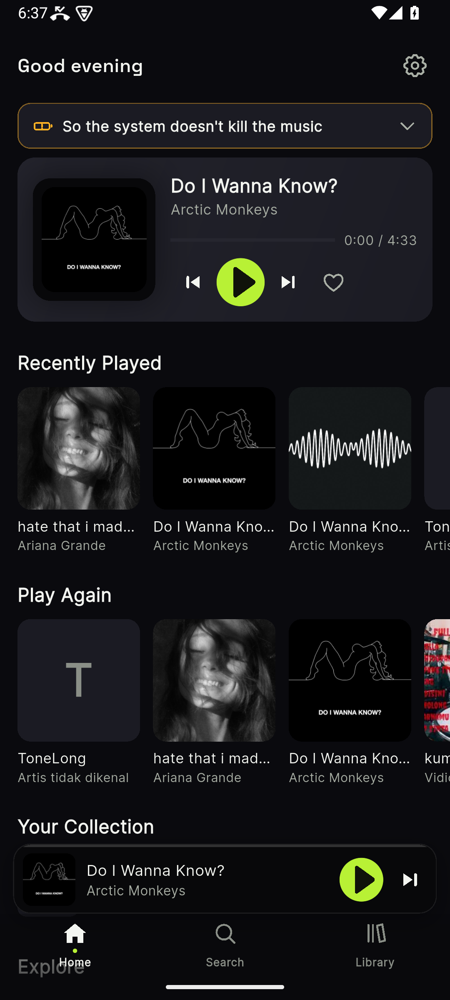
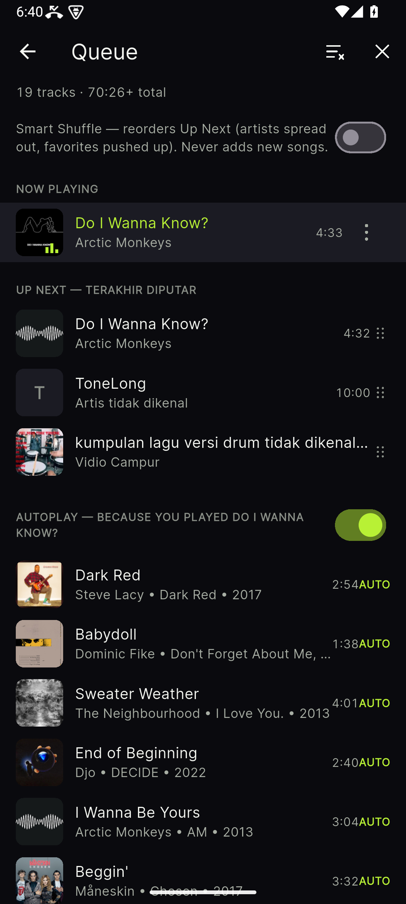
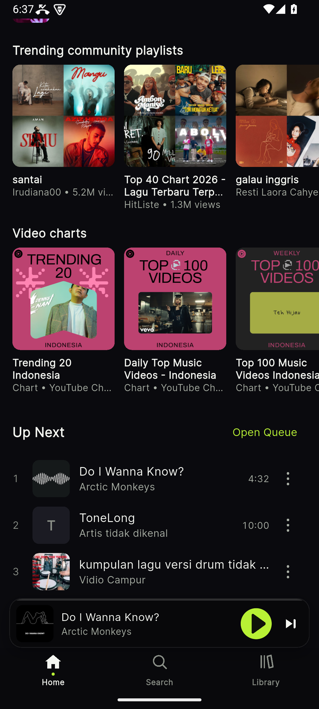
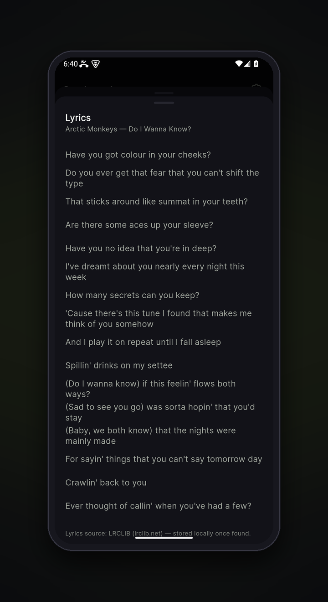
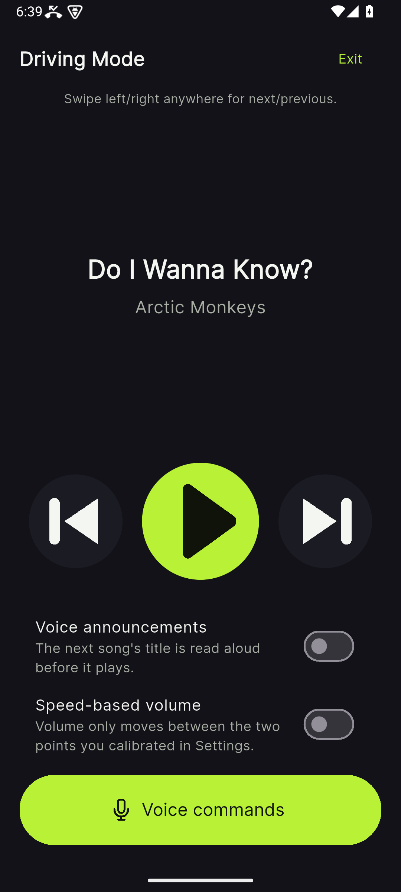

<!-- Storefront README for github.com/Riyanzakaria/Clai — v2 (visual-first rewrite,
     owner verdict 25 Oct 2026: v1 too text-dense, raw screenshots).
     v2.1 (owner decision 25 Oct 20:30): restrained emoji markers (one per section
     heading + feature bullets, Spotube/Seal style) and a big download button badge.
     Rules that still bind: English only; about the APP, never the project (no phases,
     no process, no internal codenames); every claim provable against build 2013 / 1.0.0.
     Images: framed presentation files live in repo-rapi/gambar-rapi/ locally and are
     published to ./gambar/ (same filenames + hero.png); logo stays gambar/logo-clai.png. -->

  

<h1 align="center">Clai</h1>

  <strong>The music player that asks for nothing.</strong> 
  No account. No ads. No server. No telemetry.

  
  
  
  

  

  <a href="#download">Download</a> ·
  <a href="#why-clai">Why Clai</a> ·
  <a href="#features">Features</a> ·
  <a href="#screenshots">Screenshots</a> ·
  <a href="#the-honest-part">The honest part</a> ·
  <a href="#whats-coming">What's coming</a>

  

## ⬇️ Download

**[Download clai.apk](https://github.com/Riyanzakaria/clai/releases/latest/download/clai.apk)** — always the latest version, straight from [GitHub Releases](https://github.com/Riyanzakaria/clai/releases).

1. Download the APK above.
2. Open it and allow installation when Android asks (needed once).
3. Done — from then on, updates arrive inside the app.

**Requirements:** Android 10 or newer. No account, no sign-up, and permissions are only ever asked when you open the feature that needs them.

## ✨ Why Clai

Streaming a song is easy — every app does that. These are the things Clai does that the big players don't:

- **Capture from a screenshot** — photograph a track list anywhere (another app, a chat, a poster) and on-device OCR turns it into a playable queue, reporting per item what matched and what didn't. Links and shared text work too.
- **Autoplay that doesn't drift** — continuations sit in their own labelled **AUTO** section, picked by a similarity ladder anchored to the session you started, passed through a quality gate, and your skips count as a negative signal.
- **Smart Shuffle adds nothing** — it only reorders the songs you already chose. Injecting new music is Autoplay's job, and Autoplay is always labelled.
- **Continue Tomorrow** — the sleep timer doesn't just stop the music; it bookmarks your exact position, and tomorrow Home offers to resume the same queue where you drifted off.
- **Voice Queue** — say *"play …"* or *"pause"* (Indonesian & English), on-device. Ambiguous matches are read back for confirmation, never guessed.
- **A real Car Mode** — a giant-touch surface you can swipe anywhere, voice commands, spoken announcements, and speed-following volume between two limits *you* calibrate.

## 🎧 Features

- 🎛️ **Full queue control** — play next, add to queue, drag to reorder, swipe to remove, undo, clear. Your manual queue always outranks everything else.
- 📻 **Track Radio** — an endless station from any song, from any track's menu.
- 🎚️ **Crossfade (1–12 s) and gapless** transitions, loudness normalization, and a 5-band equalizer with presets.
- ⏸️ **Honest interruptions** — if another app pauses your music, it resumes afterwards; if *you* paused it, it stays paused.
- 📥 **Offline downloads** with a downloads manager — and an offline mode that tells the truth instead of pretending everything still works.
- 🏠 **Home & Explore** — resume where you left off, personal shelves from your own listening, trending community playlists, quick picks, and video charts.
- 🔎 **Search and pages** for songs, albums, artists, and playlists, with filters, discographies, and similar artists.
- 📚 **Your library lives on your phone** — liked songs, history, your own playlists (create/edit/reorder), and local files treated as first-class citizens next to streamed tracks.
- 🔗 **Spotify playlists in, music out** — paste a public Spotify link (no account needed); Clai reads the track list and matches every song to playable audio, and says so on the page itself.
- 🎤 **Synced lyrics** from LRCLIB (plain lyrics as fallback, cached on-device), with cover-art enrichment via MusicBrainz / Cover Art Archive.
- 📊 **Optional ListenBrainz scrobbling** — off by default; bring your own token.
- 🎨 **Dynamic cover accent** — the player and Home card take a muted tint from the current cover.
- 🌐 **Indonesian & English UI** — follows your system language, switchable any time in Settings.

## 📱 Screenshots

<table align="center">
  <tr>
    <td align="center">
       
      <b>Player</b> — every control up front, Autoplay status in plain sight
    </td>
    <td align="center">
       
      <b>Home</b> — pick up where you left off, shelves from your own listening
    </td>
    <td align="center">
       
      <b>Queue</b> — your picks first; Autoplay continuations labelled AUTO
    </td>
  </tr>
  <tr>
    <td align="center">
       
      <b>Explore</b> — trending community playlists and video charts
    </td>
    <td align="center">
       
      <b>Lyrics</b> — synced, cached on your phone, credited to LRCLIB
    </td>
    <td align="center">
       
      <b>Car Mode</b> — giant touch targets, voice commands, speed-following volume
    </td>
  </tr>
</table>

## 🤝 The honest part

- **Unofficial API.** Clai plays from YouTube Music through its unofficial internal API (InnerTube) — outside the source's official terms, so the source **can change or break at any time**. Failures are surfaced honestly in the app, and a replaceable provider layer keeps the player independent of any single source.
- **Lossy in, lossy out.** The source streams Opus/AAC up to roughly 256 kbps. There is no lossless tier to unlock, and Clai will not fake one. Your own files (FLAC included) are played as-is.
- **Clean-room.** Clai contains no code, icons, artwork, or assets from Spotify or any other player, and is not affiliated with or endorsed by YouTube, Google, or Spotify.
- **Your data stays yours.** No accounts, no analytics, no telemetry, no ads. Everything personal is stored locally on your device.
- **GPL-3.0.** Anyone may use, study, and modify Clai; distributed derivatives must stay open source under the same license.

## 🗺️ What's coming

- **In 1.1.0** — home-screen widgets and long-press shortcuts, a swipeable mini player, honest data-usage estimates (with a data-saver offer on mobile data), *"Why this song?"* labels on Autoplay picks, a *"Don't play things like this"* block, undo-skip, and a sleep timer that fades out instead of cutting off.
- **In 2.0.0** — your listening stats and a "Clai Wrapped" computed entirely on your phone, library export/import in open formats (JSON/M3U), Clai Connect on your home network, and an open plug-in system for new music sources.
- **Later** — an iOS build installed by sideloading (AltStore/SideStore), plus podcasts and audiobooks. The App Store is not a realistic door for this kind of app, and this page won't pretend otherwise. Desktop and Android TV are **not** planned — Clai is a phone app by decision, not by limitation.

## 🛠️ For developers

Clai is built with **Flutter** and **ExoPlayer** (via `just_audio` / `audio_service`), in the **Volt** design language — near-black `#0A0A0E`, one lime accent `#B8F135`, spring-physics motion. Sources sit behind a single provider contract — the player never talks to a source directly — and personal data lives in a local database on the device.

Found a bug? Reports that include the app's built-in incident log (in Settings) are dramatically easier to fix.

## 🙏 Credits

Lyrics by [LRCLIB](https://lrclib.net) · cover art via [MusicBrainz](https://musicbrainz.org) / [Cover Art Archive](https://coverartarchive.org) · optional scrobbling to [ListenBrainz](https://listenbrainz.org)

## 📜 License

[GNU General Public License v3.0](LICENSE)

---

<em>Clai is free, open, and yours. If it earns a place on your home screen, tell one person who still pays a monthly fee to rent their own music.</em>

